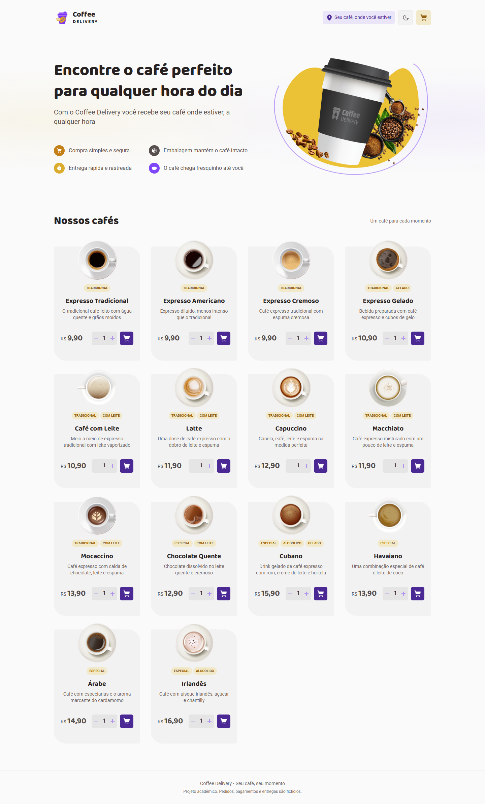
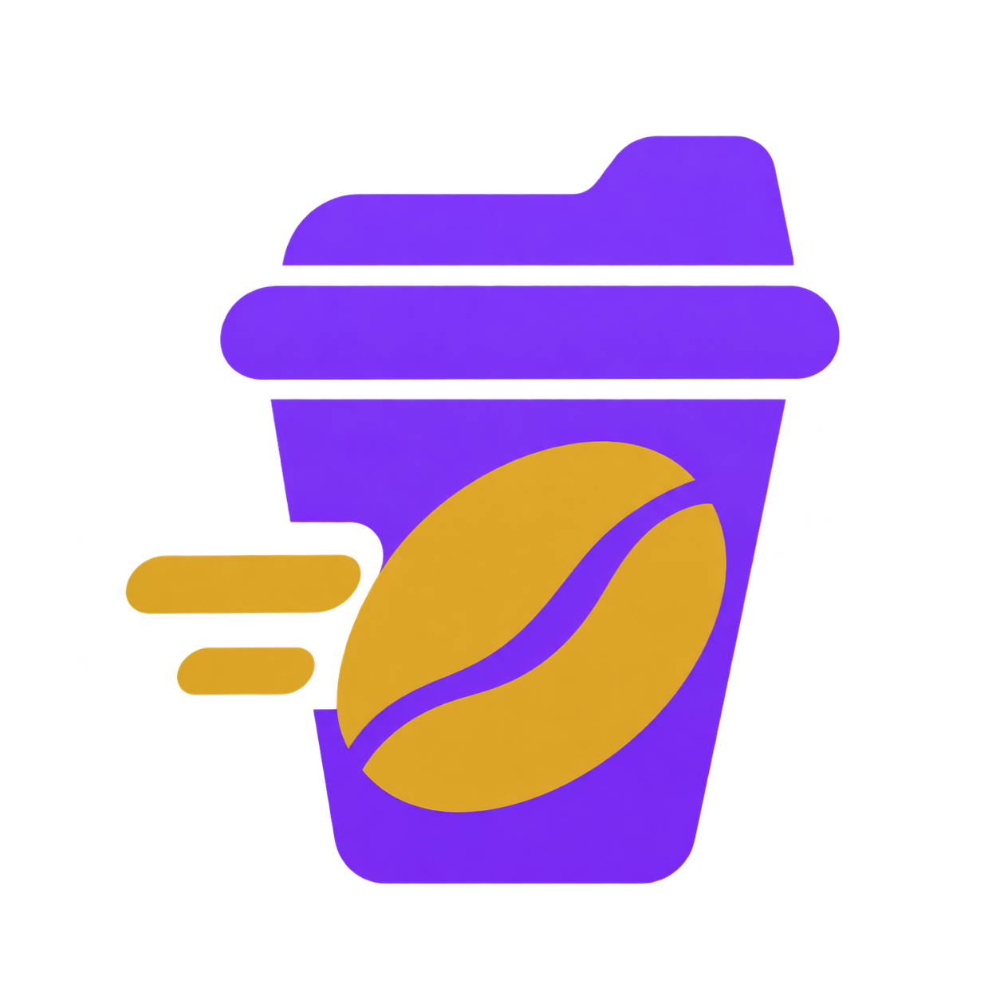

# ☕ Coffee Delivery

SPA de uma cafeteria fictícia desenvolvida com **React, Vite e TypeScript** para a disciplina Single Page Application. Escolha seus cafés, monte o carrinho, informe a entrega e confirme um pedido de demonstração.



## Executar localmente

Requisitos: Node.js 22.12+ (validado com Node 24) e npm atualizado. Se um npm antigo apresentar erro `edgesOut`, utilize o npm incluído no Node ou atualize seu npm.

```bash
npm ci
npm run dev
```

Abra o endereço informado pelo Vite. Para produção:

```bash
npm test
npm run build
npm run preview
```

## Funcionalidades

- 14 cafés com imagem, descrição, tags, preço e seletor de quantidade.
- Carrinho com Context API + useReducer, atualização imutável e persistência em LocalStorage.
- Checkout com React Hook Form + Zod, consulta automática ao ViaCEP e tratamento de erros.
- Pagamento informativo por crédito, débito ou dinheiro; frete fixo fictício de R$ 3,50.
- Confirmação por snapshot independente, mantida durante a sessão mesmo depois de limpar o carrinho.
- Temas claro/escuro, preferência persistida, fallback para o sistema e layout responsivo.
- Labels, foco visível, navegação por teclado, status acessíveis e mensagens de validação.

**Não existe pagamento real, backend próprio ou coleta de cartão.** Use dados fictícios para demonstrações. O navegador envia somente o CEP à API ViaCEP; o endereço do pedido fica no SessionStorage da sessão.

## Stack e arquitetura

React · Vite · TypeScript · React Router · styled-components · React Hook Form · Zod · Phosphor Icons · Vitest · Playwright.

`App.tsx` organiza as rotas; as páginas compõem componentes reutilizáveis. `cart.ts` contém o reducer puro e a sanitização; `store.tsx` expõe o Context e o hook `useCart`. Catálogo e frete ficam em `data.ts`; schema em `schema.ts`; snapshot em `order.ts`; consulta de CEP em `hooks/useCep.ts`. Tema e tokens ficam em `styles/`.

Valores são calculados em centavos. Quantidades aceitas: 1 a 99; o botão de diminuir fica desabilitado em 1, e a remoção é explícita. Adicionar um produto repetido acumula quantidade sem criar outra linha. A consulta de CEP cancela respostas antigas e permite correção manual quando a API falhar.

## Documentação

- [Requisitos e regras de negócio](docs/PRD_SPEC.md)
- [Arquitetura e estratégia de testes](docs/TECH_SPEC.md)
- [Planejamento e acompanhamento](docs/TASKS_SPEC.md)
- [Diretrizes para o assistente](AGENTS.md)
- [Registro real do uso de IA](docs/AI_USAGE.md)
- [Origem e atribuição dos assets](docs/ASSETS.md)
- [Relatório de validação](docs/VALIDATION.md)

## Branding com IA



**Ferramenta:** ImageGen da OpenAI, utilizada por meio do Codex em 24/11/2026. A proposta associa um copo de café, um grão e traços de movimento à ideia de entrega. Roxo e amarelo preservam a coerência com o Style Guide; Baloo 2 e Roboto são carregadas localmente.

**Prompt utilizado:**

> Create an original logo mark for Coffee Delivery, a cozy contemporary Brazilian coffee delivery brand. Icon only, no text. Purple #8047F8 takeaway coffee cup cleverly combined with a golden #DBAC2C coffee bean and two small motion strokes. Sophisticated simple flat vector-like branding, strong silhouette, clean edges, no mockup, no shadows, centered square composition with minimal padding. Transparent background.

O PNG transparente está aplicado ao Header e ao favicon. O símbolo funciona nos dois temas; o lettering HTML muda conforme os tokens de texto. A escolha prioriza uma silhueta identificável em tamanho pequeno e contraste com as superfícies. A geração não garante exclusividade de marca. Assets do desafio, fontes e ícones têm origens distintas documentadas em [ASSETS.md](docs/ASSETS.md).

## Evidências visuais

| Tela | Desktop | Mobile | Mobile escuro |
| --- | --- | --- | --- |
| Catálogo | [Home](docs/screenshots/home-desktop.png) | [Home](docs/screenshots/home-mobile.png) | [Home dark](docs/screenshots/home-mobile-dark.png) |
| Checkout | [Checkout](docs/screenshots/checkout-desktop.png) | [Checkout](docs/screenshots/checkout-mobile.png) | [Checkout dark](docs/screenshots/checkout-mobile-dark.png) |
| Confirmação | [Sucesso](docs/screenshots/success-desktop.png) | [Sucesso](docs/screenshots/success-mobile.png) | [Sucesso dark](docs/screenshots/success-mobile-dark.png) |

Capturas produzidas pela execução real dos testes, com endereço fictício e resposta de CEP controlada. Consulte o relatório de validação para saber quais checagens foram executadas.

## Testes

```bash
npm test                # regras de negócio e validação
npm run test:e2e        # fluxo real no navegador e screenshots
npm run format         # formatação do código
```

Os testes E2E usam Microsoft Edge instalado no Windows. Em outro sistema, execute `npx playwright install chromium` e defina `CI=true` para usar o Chromium do Playwright. A configuração inicia o Vite na porta 5178. Os testes usam mocks de ViaCEP para verificar sucesso, erro e concorrência sem depender da disponibilidade do serviço.

## Publicação

Build estático em `dist`. Vercel: comando `npm run build`, diretório de saída `dist`; o `vercel.json` fornece fallback de rotas. Netlify: mesmo build e diretório, com `public/_redirects`. Configuração adicional de Sites em `.openai/hosting.json`.

Repositório público: [yaascarol/coffee-delivery](https://github.com/yaascarol/coffee-delivery). Publicação da aplicação em andamento; o link será registrado após verificação.

## Referências

- [Protótipo no Figma](https://www.figma.com/design/yGPNTA0Yczb183EikXGIiA/Coffee-Delivery-%E2%80%A2-Projeto-Final-React?node-id=2-1297)
- [Enunciado](https://deluxe-blue-bc1.notion.site/Projeto-Final-05-Coffee-Delivery-React-TypeScript-IA-41bdfca74d8d8119a849e30ea492a6af)
- [React](https://react.dev/) · [React Hook Form](https://react-hook-form.com/) · [Zod](https://zod.dev/) · [ViaCEP](https://viacep.com.br/)

As capturas do Style Guide fornecidas orientaram a interface. O acesso programático ao Figma foi negado por permissão; não se declara comparação pixel a pixel com os frames completos.
